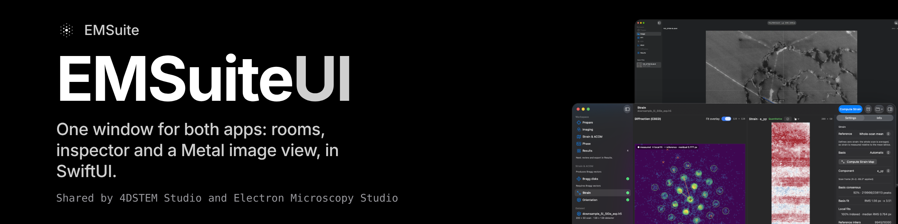

<p align="center"></p>

# EMSuiteUI

The shared user interface of the EMSuite apps, [4DSTEM Studio](https://github.com/EMSuite/4DSTEM-Studio) and
[Electron Microscopy Studio](https://github.com/EMSuite/Electron-Microscopy-Studio): the window shell, the controls, the inspector rows, the Metal image view
and the spectroscopy room's pieces, as a Swift package. SwiftUI and Metal, with AppKit only where SwiftUI cannot do the
job (each such place is named in the code). It holds no numerics: the science lives in the EMSuite kits, and EMSuiteUI only
draws what an app hands it.

**Who it is for.** The two EMSuite apps first. Anyone building a native macOS app for microscopy images and spectra can use
it too: the pieces take values and bindings, not an app's model.

## Products

| Product | Holds |
|---|---|
| `ShellMetal` | `MetalEngine`, `MetalImageView`, `MetalDisplayTransform`, the shared colormaps and their shader |
| `ShellControls` | zoom and pan (pinch, wheel, two-finger scroll; `ScrollWheelSettingRow` for Settings: the wheel zooms or pans), `NumericField`, `PaneFooter`, `ScaleBar`, colorbar, `HistogramChart`, `SegmentedControl` |
| `ShellInspector` | the inspector row kit (`InspectorRows`) |
| `ShellLayout` | the window skeleton: rooms (`WorkspaceRoom`, `PanelNavigation`), toolbar, sidebar and inspector frames, the centre column, `LayoutPolicy`, `MenuActionRelay`, `ActivityLog`, `SystemMonitor` |
| `ShellSpectroscopy` | the spectroscopy room: map tiles and the fitted map grid, the colour mix, regions (draw, edit, list), spectrum and profile panes, the periodic table, the map display popover; the EDS room both apps show (`EDXRoom`, `EDXRoomSettings`, `EDXRoomInfo`, `EDXRoomState`) |
| `ShellEDXModel` | the EDS room's model and session (`EDXSession`, regions, pins, maps, exports), no SwiftUI; the app passes its names and file opener in `EDXRoomHost`; numbers from SpectroKit |
| `ShellExport` | the figure scene (`FigureScene`, `FigureLayer`, `FigureStyle`: 90, 140 or 190 mm wide, 7 pt Helvetica) and `FigureRenderer`, which draws it as PDF and SVG with live text and as PNG, the picture at its own pixels, with `FigureMetadata` embedded; the methods record (`MethodsRecord`, schema `emsuite.methods/1` in `docs/schema/emsuite.methods-1.schema.json`: versions, sources by name, size and fingerprint with FormatoCore's provenance, phases, steps, results, citations; never a path, user or host) and `MethodsParagraph`, its paragraph for a paper; Core Graphics and Core Text, no SwiftUI |
| `ShellCrystal` | the crystal view: a phase's unit cell in 3D with RealityKit, down the beam in parallel projection, turned by drag, the arrow keys and VoiceOver actions |
| `ShellHelp` | the Help menu both apps share (`HelpCommands`), Report a Problem… (`FeedbackWindow`: the report with a diagnostics summary, sent by the person's own mail app or browser) and the crash and hang reports kept on the Mac (`DiagnosticReportCollector`) |
| `ShellPhaseLibrary` | the phase library: `Phase` (DiffractoKit's structure snapshot with its source and fingerprint), `PhaseLibrary` and its folder store, `KeychainAPIKeyStore`, `MaterialsProjectClient` (the polite client), the models of the Add Phase sheet and the Materials Project settings pane, and a phase's edits (name, notes, lattice, Reset to Source); no SwiftUI |
| `ShellPhaseViews` | the Add Phase sheet (`AddPhaseSheet`) with My Phases (`MyPhasesView`), the lattice fields for a room's inspector (`PhaseLatticeFields`) and the Materials Project settings pane (`MaterialsProjectSettingsPane`, `MaterialsProjectSettingsSections`) |
| `ShellQuickLook` | Quick Look for both apps' extensions: `QuickLookRendering` (the thumbnail's grey pixels, log scale for patterns, a trace for spectra) and `QuickLookCard` (the spacebar card: the image with its scale bar, `QuickLookScaleBar`, and the header facts), from FormatoKit's `Peek`; links no app code |
| `ShellAgentDoor` | the agent door: a local MCP server over HTTP, off until the person turns it on, with each app's tools |

`CHANGELOG.md` lists every public piece as it was added.

## Use it

Requirements: macOS 26, Swift 6.2 tools or newer. It builds with Xcode 27 and with Xcode 26.6.

```swift
// Package.swift
dependencies: [
    .package(url: "https://github.com/EMSuite/EMSuiteUI", from: "0.15.0"),
],
targets: [
    .target(name: "MyApp", dependencies: [
        .product(name: "ShellLayout", package: "MacEMUI"),
        .product(name: "ShellMetal", package: "MacEMUI"),
    ]),
]
```

Import only the modules you use. Versions follow semver; before 1.0 a minor version may change the API, and its
CHANGELOG entry has a Migration paragraph saying what to change.

## Build and test

```sh
swift build
swift test -c release --parallel
```

The Metal tests need a GPU; on a machine without one they are skipped, not failed.

## Licence

GPL-3.0-only. See `LICENSE`.
